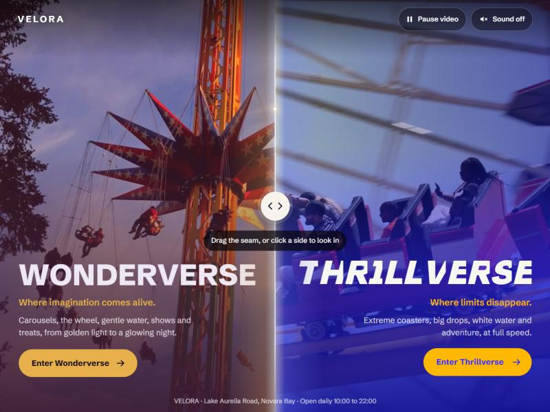
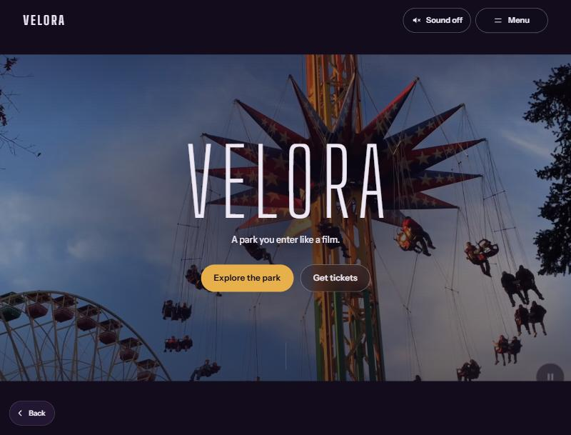
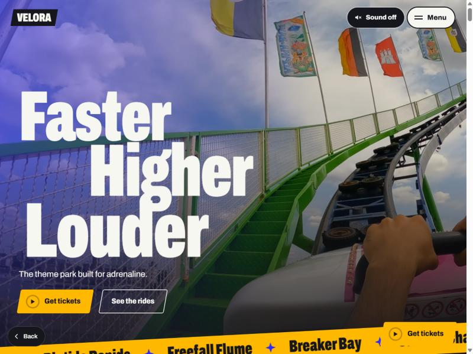

# VELORA

**An immersive, cinematic website for a fictional amusement park with two permanent worlds.**

VELORA is a single park with two experiences behind one entrance. Visitors choose **Wonderverse** for magic, gentle water, shows and family rides, or **Thrillverse** for extreme coasters, big drops and white-water adventure. Each world is a complete, independently navigable site with its own design, typography, motion, sound and media, and both read the same park content and booking logic.

> VELORA is a fictional park. Its location, hours, prices and rides are defined in one file, [`src/park/content.ts`](src/park/content.ts).

**Live site:** https://velora-park.mail-dotwatch.workers.dev



| Wonderverse: *Where imagination comes alive* | Thrillverse: *Where limits disappear* |
| --- | --- |
|  |  |

---

## Features

**Experience**
- **Entrance portal** (`/`): an opening sequence and a draggable seam that previews both worlds before the visitor enters one.
- **Two complete worlds**: each has a home page, attractions, a detail page per ride, food and shows, plan your visit with FAQs, and tickets.
- **Remembered preference**: the last world a visitor chose is remembered, and a switcher moves them to the equivalent page in the other world.
- **Cinematic motion**: GSAP ScrollTrigger choreography, pinned sections and Framer-style interface transitions via `motion`, with smooth scrolling through Lenis on desktop.
- **Sound design**: Web Audio, off by default and remembered. Each world has its own voice: warm reverb and music-box bells for Wonderverse, compressed and punchy for Thrillverse.
- **Accessibility**: reduced motion is respected everywhere (preview with `?motion=reduced`), with keyboard access and visible focus states.

**Media delivery**
- Video quality adapts to the connection. The connection is measured once, clips start at 1080p (720p on slow links or phones), and a stall guard steps down mid-play and recovers from errors.
- Off-screen video pauses and releases its download; there is one active video decoder at a time on desktop to avoid playback jitter.
- Photos and posters ship as pre-sized WebP generated at export time.

**Bookings**
- Visitors book tickets on each world's tickets page through a shared `BookingForm`, with no online payment.
- Bookings are created through a Supabase RPC (`create_booking`), and the browser only ever holds the public anon key.
- Staff sign in at `/admin` (Supabase Auth) to view and manage bookings. Admins are rows in `public.admins`, enforced by row-level security.
- Confirmation emails are sent by a Supabase Edge Function through Resend, so the email key never reaches the browser.

**Studio (internal, development only)**
- `/studio` holds the media-selection and design tools used to build the site. It is never linked from public pages and is excluded from the static export.

---

## Architecture

```
src/
  app/                 Next.js App Router: portal, /wonderverse/*, /thrillverse/*, /admin, /studio
  concepts/a/          Wonderverse design, pages and motion
  concepts/b/          Thrillverse design, pages and motion
  experiences/         Shared shell for both worlds (layout, switcher, navigation)
  park/                Single source of truth: content.ts (park facts), tickets.ts, booking.ts (Supabase client)
  shared/
    media/             Adaptive video delivery, poster fallbacks, playback guards
    sound/             Web Audio engine and per-world sound palettes
    motion/            Motion helpers and reduced-motion handling
    booking/           Shared booking form
supabase/
  migrations/          Schema, row-level security and RPCs (bookings, ticket types, admins)
  functions/           Edge Function: booking confirmation email (Resend)
scripts/               Media pipeline: sizing, grading, export
deploy/wrangler.jsonc  Cloudflare Workers static-assets deployment
```

**Design principles**
- **Shared logic, separate experiences.** Business logic (content, tickets, bookings) lives once in `src/park`. Each world owns its presentation, so the two can evolve independently without duplicating business rules.
- **Static front end, managed back end.** The site is exported as static files and deployed to a CDN. Data and authentication live in Supabase, protected by row-level security. Only the anon key is shipped to browsers.
- **Single source of park facts.** Hours, prices and ride details are changed in one file rather than hard-coded across pages.

---

## Technologies

| Area | Technology |
| --- | --- |
| Framework | Next.js 16 (App Router, static export), React 19, TypeScript |
| Styling | Tailwind CSS v4, CSS for masks and depth |
| Motion | GSAP + ScrollTrigger, `@gsap/react`, `motion`, Lenis |
| Audio | Web Audio API |
| Backend | Supabase: Postgres, Row-Level Security, RPC functions, Auth, Edge Functions (Deno) |
| Email | Resend (called from a Supabase Edge Function) |
| Hosting | Cloudflare Workers with static assets (free tier) |
| Tooling | ESLint, TypeScript, Supabase CLI, Wrangler |

---

## Run it locally

Requirements: Node.js 20 or later.

```bash
git clone https://github.com/<your-username>/<repository>.git
cd <repository>
npm install
cp .env.example .env.local   # then fill in your own Supabase values (see below)
npm run dev                  # http://localhost:3000
```

Without Supabase values, the site still runs; the booking form reports that bookings are not configured.

### Environment variables

Only public values belong in the browser:

| Variable | Used by | Purpose |
| --- | --- | --- |
| `NEXT_PUBLIC_SUPABASE_URL` | Browser | Your Supabase project URL |
| `NEXT_PUBLIC_SUPABASE_ANON_KEY` | Browser | Public anon key, protected by row-level security |

Never put a service-role key, database password or email API key in `NEXT_PUBLIC_*` variables or in the repository. Server-side secrets are set on Supabase (`npx supabase secrets set ...`).

### Set up the database

```bash
npx supabase link --project-ref <your-project-ref>
npx supabase db push          # applies supabase/migrations
```

Create an admin by signing up through Supabase Auth, then adding that user's ID to `public.admins`.

### Build and deploy

```bash
node scripts/export.mjs                          # size media, build static export into out/
npx wrangler deploy -c deploy/wrangler.jsonc     # deploy to Cloudflare (run `npx wrangler login` once)
```

Booking confirmation emails are optional. To enable them, deploy the `send-booking-email` Edge Function and set `RESEND_API_KEY`, `MAIL_FROM` and `MAIL_REPLY_TO` as Supabase secrets.

### Media

This repository holds the code, content records and documentation, not the photographs, videos or audio. The providers' licences (Pexels, Pixabay, Mixkit) do not allow redistributing raw files, so those files are not published here. Videos stream from the providers' own CDNs. Sources and licences for every asset are in [docs/ASSETS.md](docs/ASSETS.md) and `media/sources.json`.

Running the full site needs its media, which must be re-supplied from the listed sources (see `scripts/` and `docs/ASSETS.md`). A clean clone has not been verified to build with the media missing.

---

## Highlights

- Designed a two-world information architecture in which one codebase serves two distinct visual and motion systems without duplicating business logic.
- Implemented a booking system with Supabase RPCs and row-level security, so the public client can create bookings but cannot read them.
- Built adaptive media playback: connection-aware quality, a single active decoder, stall recovery and off-screen pausing.
- Made motion accessible, with reduced-motion support and sound that is off by default.

